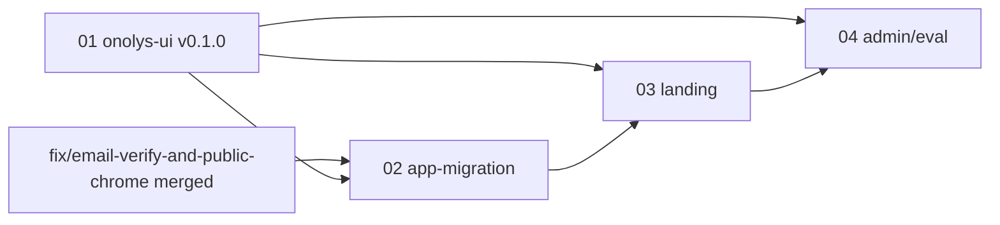

# Design system: index

## Sub-projects
| # | Sub-project | Phase | Depends on | Status | PRD |
|---|---|---|---|---|---|
| 01 | onolys-ui | 1 | none | draft | [PRD](01-onolys-ui/PRD.md) |
| 02 | app-migration | 2 | 01 v0.1.0 tag + `fix/email-verify-and-public-chrome` merged | draft | [PRD](02-app-migration/PRD.md) |
| 03 | landing | 3 | 01 | not yet designed | - |
| 04 | admin-eval-frontend | 4 | 01 | not yet designed | - |

## Dependency graph

Rollout order: app, then landing, then admin/eval.

## Locked decisions
- Tailwind v4 + shadcn/ui (Radix); CSS-variable tokens.
- New public repo `Onolys/onolys-ui`, consumed as git dependency pinned to tags (no npm registry).
- Dark mode follows device (`prefers-color-scheme`); no toggle.
- Teal `#0b5f5a` brand, existing score colors, Inter self-hosted.
- Strict CSP kept, Playwright CSP smoke test; any relaxation needs owner approval. Owner 2026-11-23: build/hosting checks may be changed or removed when they block the design system.
- Rollout: app, landing, admin/eval.

## Risks / Open Questions (consolidated)
**PRD 01 (onolys-ui)**
- [RESOLVED: 2026-11-23 — Radix Select; native fallback only if CSP smoke fails]
- [RESOLVED: owner 2026-11-23 — prefer Radix Dialog/AlertDialog with build check adjusted; native `<dialog>` only if CSP smoke fails; runtime CSP verification remains a task-level check.]
- [OPEN: or drop] Keep `legacy.css` color aliases or force-migrate.
- [OPEN: verify] Storybook 10 + Vite 8 compat (Storybook vs Ladle).
- [OPEN] Verify current shadcn CLI conventions for Tailwind v4; Storybook/Vite 8/TS compat; Tailwind `@source` through git-dep install.
- [OPEN] TS version: emitted `.d.ts` must typecheck under web TS 6.0.3 and admin TS 7.
- [OPEN] Node 22 `npm install github:` with committed dist: confirm no `prepare` runs.
- [OPEN] `font-src 'self'`: confirm fonts not inlined as data: (Vite `assetsInlineLimit`) in consumers.

**PRD 02 (app-migration)**
- [OPEN in SP1] If SP1 drops `legacy.css`, web keeps private `legacy-tokens.css`.
- [OPEN: confirm needed set] jsdom shims for Radix (`ResizeObserver`, `hasPointerCapture`, `scrollIntoView`, `matchMedia`).
- [RESOLVED: 2026-11-23 — approved] `@axe-core/playwright` devDep (web; also onolys-ui checks).
- [verify: OPEN] `pr-preview.yml` has no separate install step.
- [OPEN] `npm ci` must not use ssh URL; use `git+https`.
- [OPEN: pick numbers after baseline] Soft bundle budget (JS gzip +60KB, CSS gzip +15KB).
- [RESOLVED: owner 2026-11-23 — build/hosting checks may be changed or removed when they block the design system; keep the CSP itself strict (style-src 'self') and prove it with the Playwright CSP smoke; prefer Radix Dialog/AlertDialog] (`build.test.ts` `createElement("style")` ban vs `react-style-singleton`.)
- [OPEN] Radix `aria-hidden` on siblings may break test helpers.
- [OPEN] Tailwind `@source` through `file:` symlink (local dev).
- [OPEN] Preflight impact on not-yet-migrated screens.
- [OPEN] AuthAction (400 lines) may need splitting.
- [OPEN] MSW service worker under CSP preview (`worker-src`).
