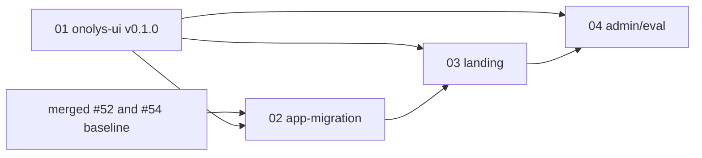

# Design system: index

## Sub-projects
| # | Sub-project | Phase | Depends on | Status | PRD |
|---|---|---|---|---|---|
| 01 | onolys-ui | 1 | none | complete | [PRD](01-onolys-ui/PRD.md) |
| 02 | app-migration | 2 | 01 v0.1.0 tag + merged #52/#54 baseline | ready / planned | [PRD](02-app-migration/PRD.md) |
| 03 | landing | 3 | 01 | not yet designed | - |
| 04 | admin-eval-frontend | 4 | 01 | not yet designed | - |

## Dependency graph

Rollout order: app, then landing, then admin/eval.

SP2 preservation baseline refreshed after rebasing onto main `d88fbc6` (merged #54): current /new chooser and /sessions list, safe new-tab /sample navigation, compact footer, and shared ReportView/native CodedTranscriptDialog. Its phases and todo statuses remain unchanged; no app migration has started.

## Locked decisions
- Tailwind v4 + shadcn/ui (Radix); CSS-variable tokens.
- New public repo `Onolys/onolys-ui`, consumed as git dependency pinned to tags (no npm registry).
- Dark mode follows device (`prefers-color-scheme`); no toggle.
- Teal `#0b5f5a` brand, existing score colors, Inter self-hosted.
- Strict CSP kept, Playwright CSP smoke test; any relaxation needs owner approval. Owner 2026-11-23: build/hosting checks may be changed or removed when they block the design system.
- Rollout: app, landing, admin/eval.

## Risks / Open Questions (consolidated)
**PRD 01 (onolys-ui)**
- [VERIFIED: Task 7 — native Select fallback selected after two Radix inline style CSP violations; strict CSP retained, no Radix-only Select helper exports.]
- [RESOLVED: owner 2026-11-23 — prefer Radix Dialog/AlertDialog with build check adjusted; native `<dialog>` only if CSP smoke fails; runtime CSP verification remains a task-level check.]
[RESOLVED: orchestrator default 2026-11-23 — keep `legacy.css` aliases; removed in SP2 final cleanup; verified in Task 4]
[RESOLVED: orchestrator default 2026-11-23 — Storybook 10 if Vite 8 compatible, else Ladle; verified in Task 2]
[RESOLVED: orchestrator default 2026-11-23 — follow current shadcn Tailwind v4 conventions; `@source` through git install proven in consumer fixture; verified in Task 2/11/13]
[RESOLVED: orchestrator default 2026-11-23 — `.d.ts` from TS 6.0.x; fixture typechecked under TS 6 and 7 in CI; verified in Task 10]
[RESOLVED: orchestrator default 2026-11-23 — dist on release tag commits only, no `prepare`; Node 22 git+https install smoke in CI; verified in Task 13]
[RESOLVED: orchestrator default 2026-11-23 — woff2 files; consumers set `assetsInlineLimit` so no `data:` fonts; verified in Task 11]

**PRD 02 (app-migration)**
- [RESOLVED: orchestrator default 2026-11-23 — bridge via SP1 `legacy.css`, removed in final cleanup; private `legacy-tokens.css` only if SP1 drops it]
- [RESOLVED: orchestrator default 2026-11-23 — standard Radix jsdom shim set in vitest setup]
- [RESOLVED: 2026-11-23 — approved] `@axe-core/playwright` devDep (web; also onolys-ui checks).
- [RESOLVED: orchestrator default 2026-11-23 — verify install covers git dep, add if not]
- [RESOLVED: orchestrator default 2026-11-23 — `github:` resolves via git+https; verify `npm ci` in CI]
- [RESOLVED: orchestrator default 2026-11-23 — baseline in Phase 0; soft budget baseline +25%, warning only]
- [RESOLVED: owner 2026-11-23 — build/hosting checks may be changed or removed when they block the design system; keep the CSP itself strict (style-src 'self') and prove it with the Playwright CSP smoke; prefer Radix Dialog/AlertDialog] (`build.test.ts` `createElement("style")` ban vs `react-style-singleton`.)
- [RESOLVED: orchestrator default 2026-11-23 — role queries scoped; helpers fixed in first modal phase]
- [RESOLVED: orchestrator default 2026-11-23 — `@source` to real path, documented]
- [RESOLVED: orchestrator default 2026-11-23 — cascade layers; Phase 0 screenshots]
- [RESOLVED: orchestrator default 2026-11-23 — split only if >50% touched; decided in Phase 2]
- [RESOLVED: orchestrator default 2026-11-23 — MSW only where needed; `worker-src 'self'` in test server config only]

## Delivery evidence
SP1 is complete: [public v0.1.0 release](https://github.com/Onolys/onolys-ui/releases/tag/v0.1.0), [implementation record](code-2026-11-23-0700.md), and [full review PASS](review-2026-11-23-0653.md). SP2 prerequisites (tag and merged #52) are met; all SP2 tasks remain todo. Owner still enables protection on onolys-ui main.
